# Prints — evidências do funcionamento

Prints do item 9 do relatório ("Apresentação do programa em funcionamento").
Pasta fora do Git: contém o rosto do Nicolas.

> **Sobre as imagens:** esta é a única pasta do repositório com fotos de rosto,
> e todas mostram apenas o rosto do autor (Nicolas), publicado por decisão própria.
> As fotos usadas nos testes automatizados continuam fora do Git
> (`biometria-service/fotos/`), por serem dado biométrico.

- Todos os usuários foram cadastrados pela tela, com o rosto do Nicolas e a senha `123456`.
- Única foto de arquivo: `img_outraPessoa.jpg`, no print 09 (só a resposta aparece, sem o rosto).

## Índice

| # | Print | O que mostra |
|---|---|---|
| 01 | [01-pagina-inicial](#01--página-inicial) | Página inicial |
| 02 | [02-cadastro-validacao](#02--validação-do-cadastro) | Erros com os campos vazios |
| 03 | [03-cadastro-camera](#03--câmera-ligada) | Câmera ligada com a dica |
| 04 | [04-cadastro-sucesso](#04--cadastro-concluído) | Cadastro como Analista (nível 1) |
| 05 | [05-cadastro-sem-rosto](#05--foto-sem-rosto) | Foto sem rosto recusada |
| 06 | [06-dbeaver-promocao](#06--promoção-para-os-níveis-2-e-3) | Promoção pelo DBeaver |
| 07 | [07-login-credenciais-invalidas](#07--credenciais-inválidas) | "Email ou senha inválido." |
| 08 | [08-login-popup](#08--popup-de-confirmação-facial) | Popup da foto |
| 09 | [09-rest-client-outra-pessoa](#09--outra-pessoa-com-a-senha-certa) | Outra pessoa barrada |
| 10 | [10-login-servico-indisponivel](#10--serviço-indisponível) | Serviço de reconhecimento fora do ar |
| 11 | [11-resultado-analista](#11--analista-nível-1) | 3 informações |
| 12 | [12-resultado-diretor](#12--diretor-nível-2) | 6 informações |
| 13 | [13-resultado-ministro](#13--ministro-nível-3) | 9 informações |
| 14 | [14-xss](#14--proteção-contra-xss) | Nome com HTML exibido como texto |
| 15 | [15-dbeaver-log-acesso](#15--log-de-acesso) | Tabela `log_acesso` |
| 16 | [16-dbeaver-relatorios](#16--relatórios) | Relatórios do log |
| 17 | [17-log-python-distancias](#17--distâncias-no-log-do-python) | Distância, confiança e limiar |

---

## Funcionalidades pedidas

### 01 — Página inicial
Tela: `http://localhost:8080`.

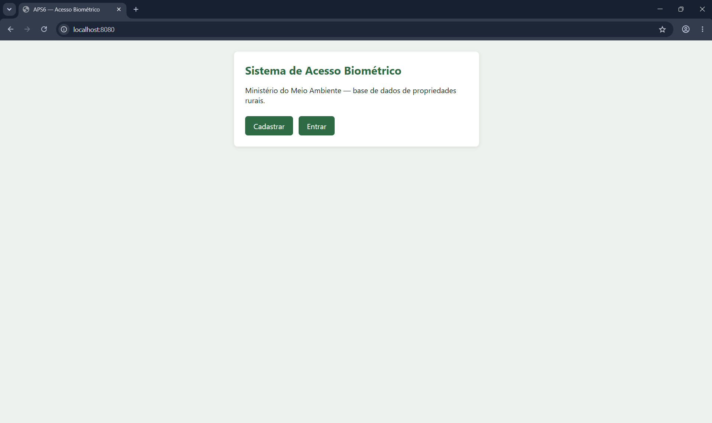

### 02 — Validação do cadastro
Tela: "Cadastrar" com foto tirada e os campos vazios.

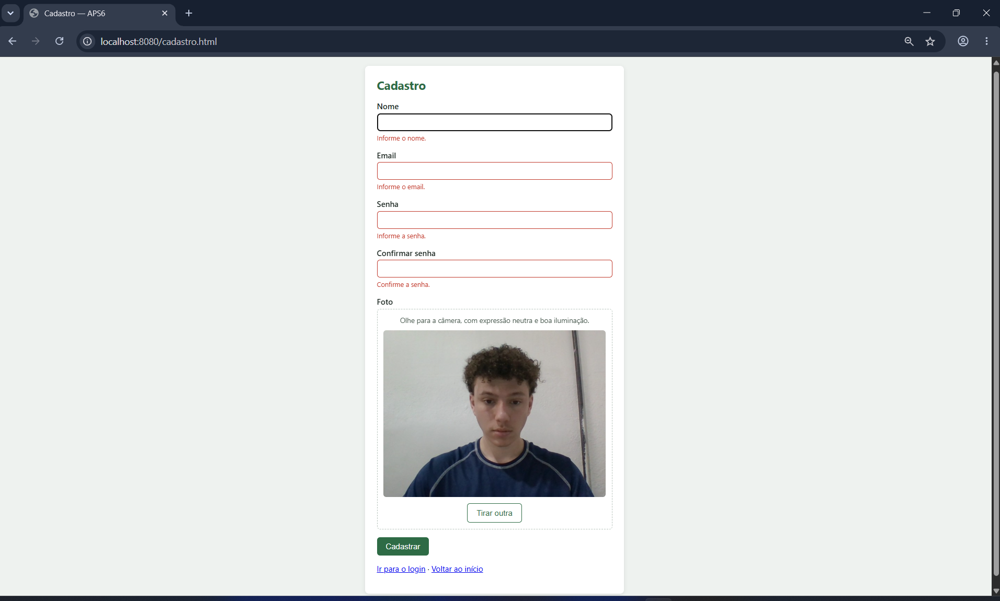

### 03 — Câmera ligada
Tela: "Ligar câmera", com a dica de captura visível.

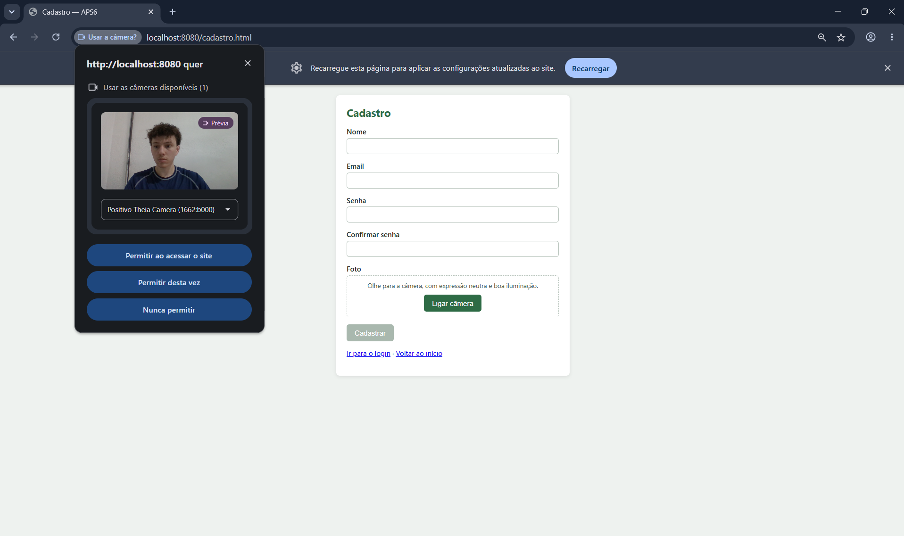

### 04 — Cadastro concluído
Tela: cadastro de `nicolas@exemplo.com`. O cargo (Analista, nível 1) é atribuído pelo servidor.

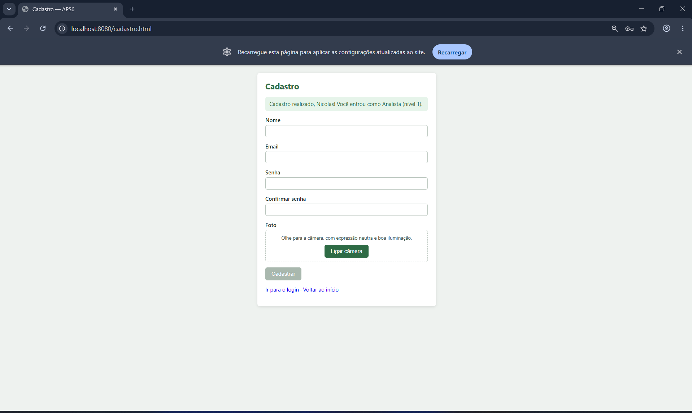

### 05 — Foto sem rosto
Tela: foto com a mão tampando a câmera.

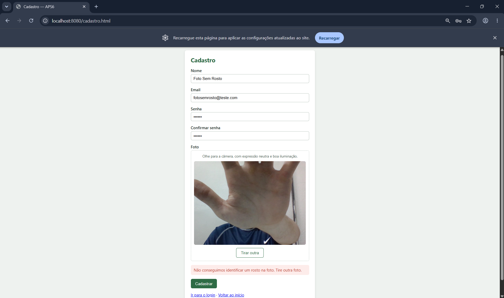

### 06 — Promoção para os níveis 2 e 3
DBeaver: `UPDATE usuario SET cargo_id = 2 / 3`. Níveis 2 e 3 não são autoatribuíveis.

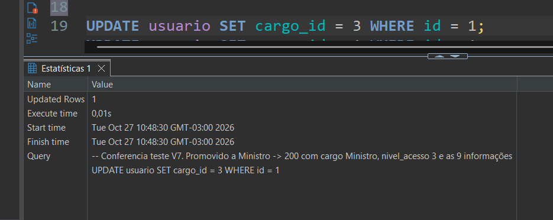

### 07 — Credenciais inválidas
Tela: login com senha errada.

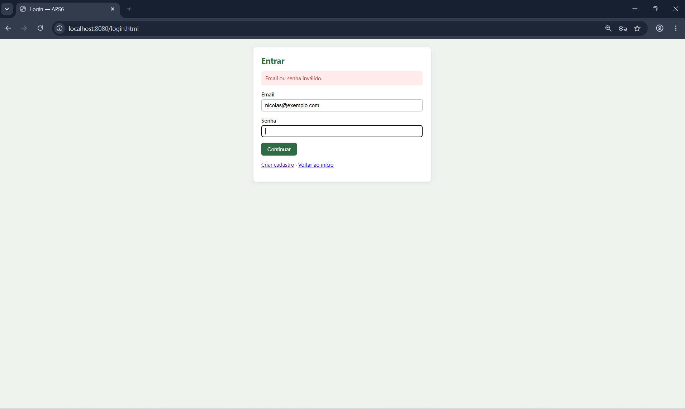

### 08 — Popup de confirmação facial
Tela: login com senha certa.

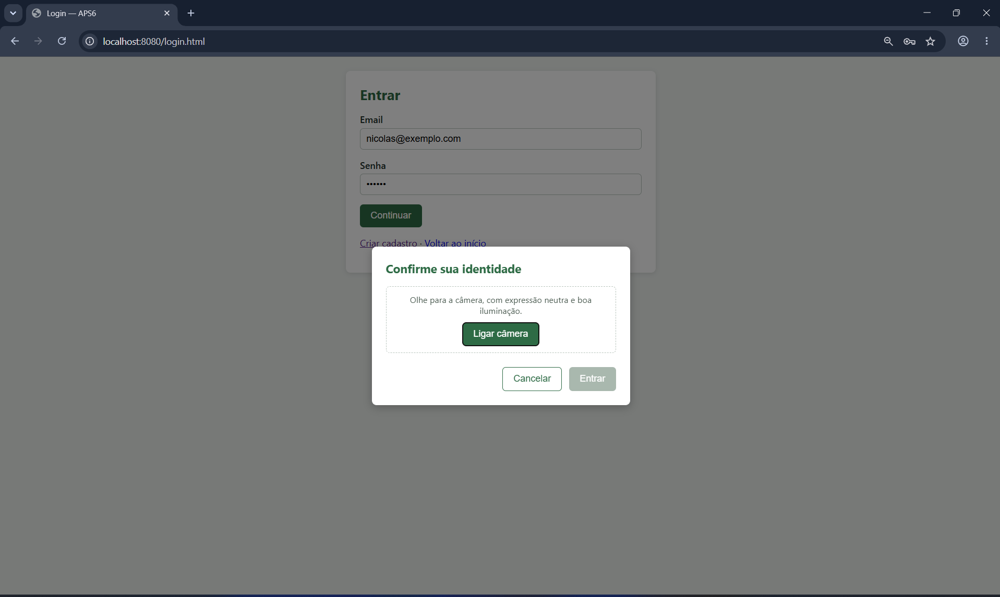

### 09 — Outra pessoa com a senha certa
REST Client: teste V9 do `teste-login.http` → `401 CONFIANCA_ABAIXO_LIMIAR`.

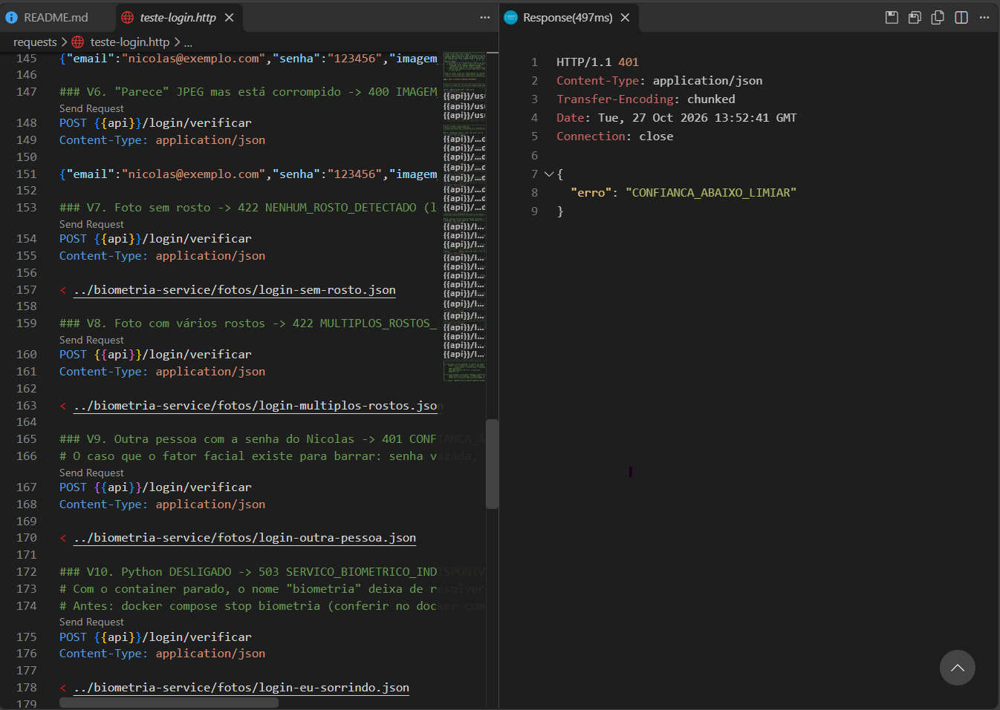

### 10 — Serviço indisponível
Tela, com `docker compose stop biometria`.

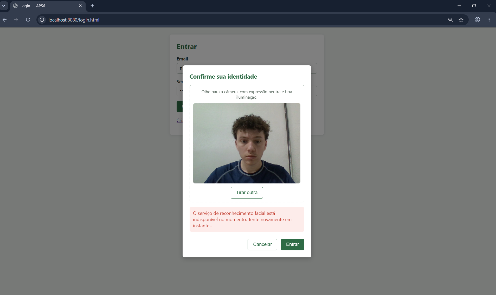

### 11 — Analista (nível 1)
Tela: login de `nicolas@exemplo.com`.

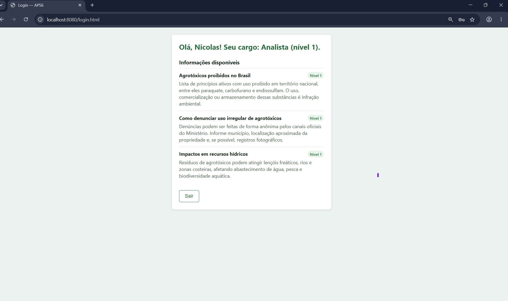

### 12 — Diretor (nível 2)
Tela: login de `diretor@exemplo.com`.

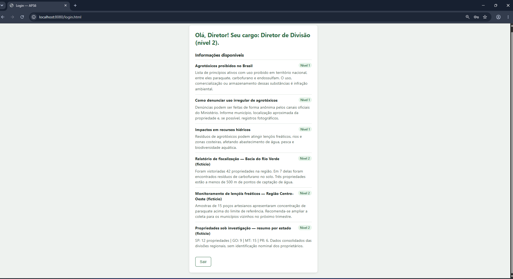

### 13 — Ministro (nível 3)
Tela: login de `ministro@exemplo.com`.

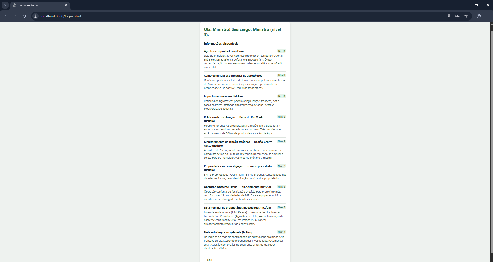

---

## Funções extras e relatórios

### 14 — Proteção contra XSS
Tela: login de `xss@exemplo.com`. O nome `<b>Teste</b>` aparece como texto, sem negrito.

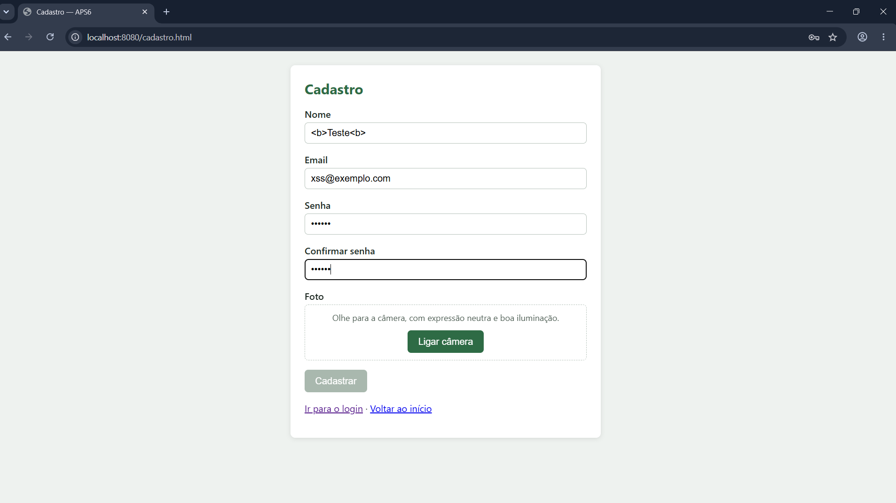

### 15 — Log de acesso
DBeaver: R8 do `relatorios.sql`.

### 16 — Relatórios
DBeaver: `relatorios.sql` (`Alt+X`).

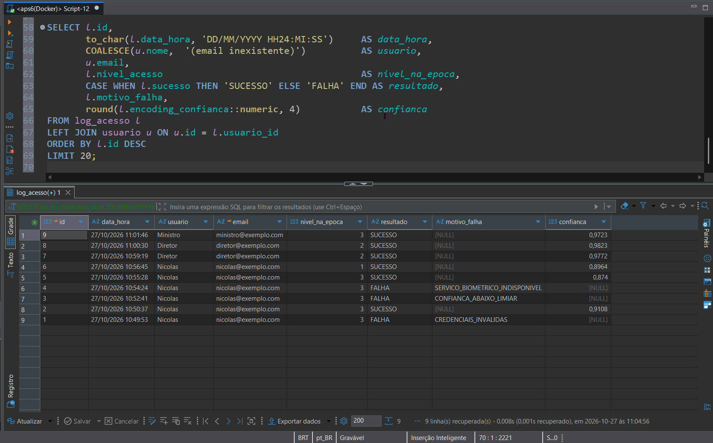

### 17 — Distâncias no log do Python
Terminal: `docker compose logs biometria | grep verificar`.

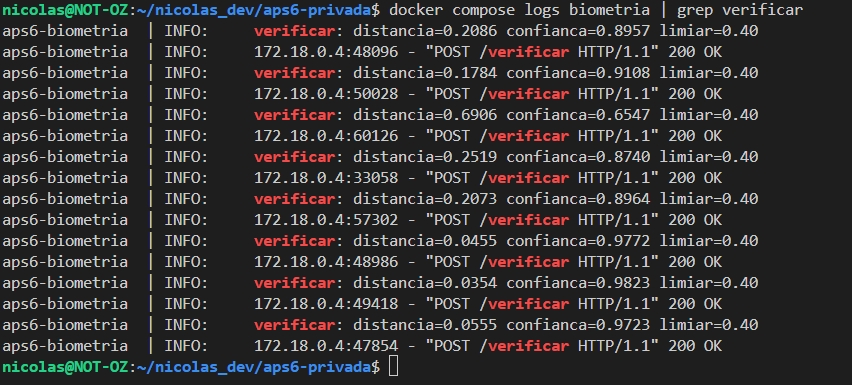